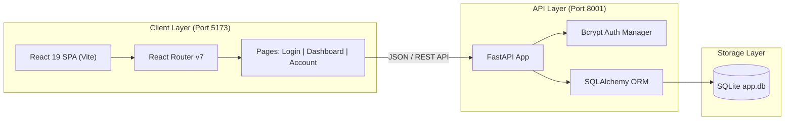

<div align="center">

# ⚡ Basic WebApp

### *Modern Full-Stack Dashboard & User Portal*

[](https://react.dev/)
[](https://www.typescriptlang.org/)
[](https://vitejs.dev/)
[](https://fastapi.tiangolo.com/)
[](https://www.sqlite.org/)
[](LICENSE)

<br/>

> A full-stack web application featuring a sleek dark-mode KPI Performance Dashboard, custom authentication, and user profile management — powered by a **React + TypeScript** frontend and a **FastAPI + SQLAlchemy** backend.

---

[Explore Features](#-features) • [Quick Start](#-quick-start) • [Architecture](#-architecture) • [Roadmap](#-interactive-roadmap) • [API Docs](#-api-endpoints)

---

</div>

<br/>

## 🎯 Project Overview

This project is built from the ground up as a responsive, real-time analytics and user management dashboard.

* **Frontend**: React 19 single-page application (SPA) with TypeScript, Vite, and React Router 7.
* **Backend**: Asynchronous RESTful API powered by Python's FastAPI framework.
* **Security & Persistence**: SQLite engine managed through SQLAlchemy models with bcrypt password hashing.

---

## 🏗️ Architecture



---

## ✨ Features

<table>
  <tr>
    <td width="50%">
      <h3>📊 Performance KPI Dashboard</h3>
      <ul>
        <li>Real-time production, order, and sales metrics</li>
        <li>Quarterly KPI trend visualization & line graphs</li>
        <li>Downtime breakdown analytics & causes</li>
        <li>Compact machine efficiency charts</li>
      </ul>
    </td>
    <td width="50%">
      <h3>🔐 Authentication & Account</h3>
      <ul>
        <li>Dark glassmorphic login interface</li>
        <li>Secure password hashing using <code>bcrypt</code></li>
        <li>User profile management & account settings</li>
        <li>Dynamic schema validation via TypeScript interfaces</li>
      </ul>
    </td>
  </tr>
</table>

---

## 🚀 Quick Start

Get the entire full-stack application running on your machine in under 2 minutes:

### 1️⃣ Clone the Repository
```bash
git clone https://github.com/Jakelrnr/Basic-Webapp.git
cd Basic-Webapp
```

<details open>
<summary><b>💻 2️⃣ Frontend Setup (React + TypeScript)</b></summary>

```bash
# Navigate to the frontend directory
cd my-react-app

# Install project dependencies
npm install

# Start the Vite local development server
npm run dev
```

Your app will be live at: **`http://localhost:5173`**

</details>

<details open>
<summary><b>🐍 3️⃣ Backend Setup (FastAPI + Python)</b></summary>

```bash
# Navigate to the backend directory
cd backend

# Install dependencies (FastAPI, Uvicorn, SQLAlchemy, Bcrypt)
pip install fastapi uvicorn sqlalchemy bcrypt

# (Optional) Initialize SQLite database tables
python make_db.py

# Launch the FastAPI backend server
uvicorn main:app --reload --port 8001
```

Interactive API documentation available at: **`http://localhost:8001/docs`**

</details>

---

## 📡 API Endpoints

<details>
<summary><b>Click to expand backend API routes</b></summary>

<br/>

| Method | Endpoint | Description | Request Body |
|:---:|:---|:---|:---|
| `GET` | `/` | API Healthcheck & greeting | _None_ |
| `GET` | `/users` | List registered users | _None_ |
| `POST` | `/users` | Register a new user | `{ "username": "...", "email": "...", "password": "..." }` |
| `POST` | `/login` | Authenticate user credentials | `{ "username": "...", "password": "..." }` |

> 💡 **Tip:** FastAPI automatically generates interactive OpenAPI documentation at `/docs` (Swagger UI) and `/redoc`.

</details>

---

## 📂 Project Structure

```text
Basic-Webapp/
├── backend/
│   ├── app.db                # SQLite database (git-ignored)
│   ├── Auth_manager.py       # Bcrypt hash generation and validation
│   ├── db_test.py            # Database unit tests & verification
│   ├── main.py               # FastAPI application entrypoint
│   ├── make_db.py            # Database schema initialization script
│   ├── models.py             # SQLAlchemy dynamic schema & table builders
│   └── user_db.py            # Engine connection & foreign key hooks
├── my-react-app/
│   ├── src/
│   │   ├── assets/           # Images, SVGs, and visual icons
│   │   ├── components/       # Reusable UI widgets (cards, sidebars, charts)
│   │   ├── pages/            # Application views (LoginPage, Homepage, AccountPage)
│   │   ├── App.css           # Component styles
│   │   ├── App.tsx           # Router configuration & root view
│   │   ├── index.css         # Global design tokens & styling
│   │   ├── main.tsx          # DOM mounting entrypoint
│   │   └── types.ts          # Centralized TypeScript interfaces
│   ├── package.json          # Node dependencies & run scripts
│   ├── tsconfig.json         # TypeScript compiler configuration
│   └── vite.config.ts        # Vite bundling & plugin settings
├── .gitignore                # Protects secrets, node_modules & database
└── README.md                 # Project documentation
```

---

## 🗺️ Interactive Roadmap

Track upcoming features and development phases:

- [x] **Phase 1: TypeScript Core Types**
  - [x] Centralize `User`, `KpiCard`, and `LoginCredentials` interfaces
  - [x] Configure strict compiler checks
- [x] **Phase 2: Single-Page Routing**
  - [x] Install and configure React Router v7
  - [x] Scaffold `LoginPage`, `Homepage`, and `AccountPage`
- [ ] **Phase 3: High-Fidelity Dark UI Design**
  - [ ] Implement glassmorphic input fields with embedded user/lock icons
  - [ ] Build branded pill-shaped login button
- [ ] **Phase 4: Authentication State & Session**
  - [ ] JWT / Session token integration
  - [ ] Protected route guards
- [ ] **Phase 5: Performance KPI Dashboard Layout**
  - [ ] Persistent left icon sidebar
  - [ ] Grid layout for summary metric tiles
- [ ] **Phase 6: Interactive Visualizations & Charts**
  - [ ] Production trend line charts
  - [ ] Downtime donut / pie distribution charts

---

## 🛡️ Security & Good Practices

<details>
<summary><b>Click to expand security considerations</b></summary>

- **Salted Password Hashing**: Passwords are never stored in plaintext. Passwords pass through `bcrypt.gensalt()` before entering SQLite.
- **Git Safety Filter**: A strict `.gitignore` ensures credentials, local `.env` files, compiled Python caches (`__pycache__`), and database binaries (`*.db`) are never pushed into remote version control.
- **Strict Typing**: TypeScript enforces data shape consistency across API requests and frontend components.

</details>

---

## 📄 License

This project is licensed under the [Apache License 2.0](LICENSE) - see the LICENSE file for details.

<div align="center">
  <sub>Built with ❤️ by <a href="https://github.com/Jakelrnr">Jakelrnr</a></sub>
</div>
